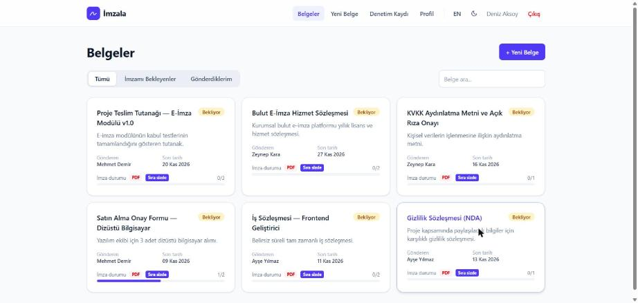
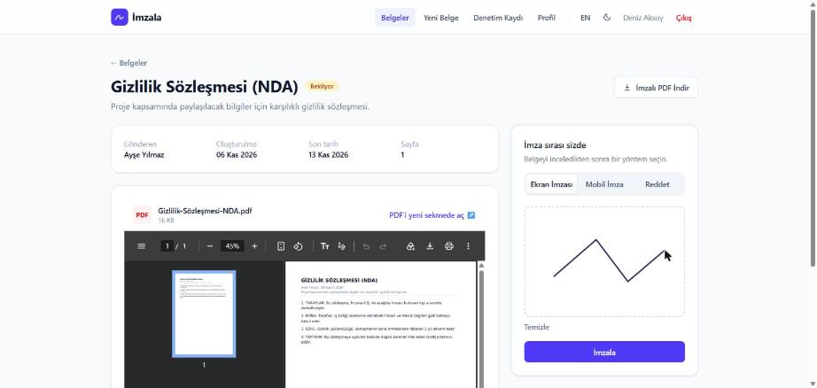
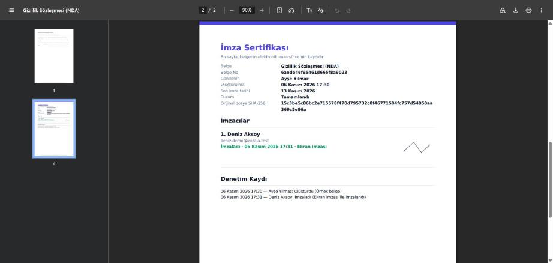
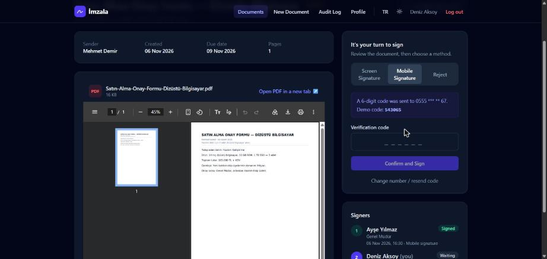
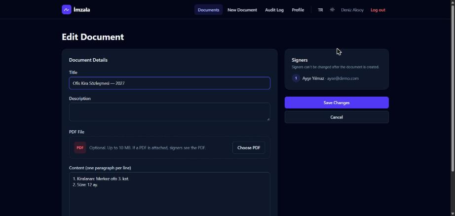
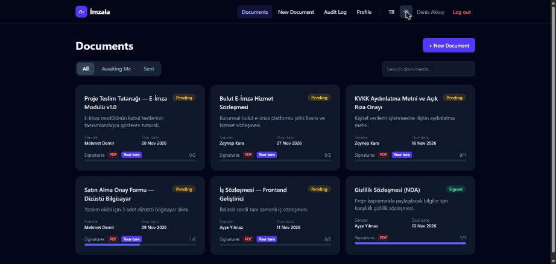
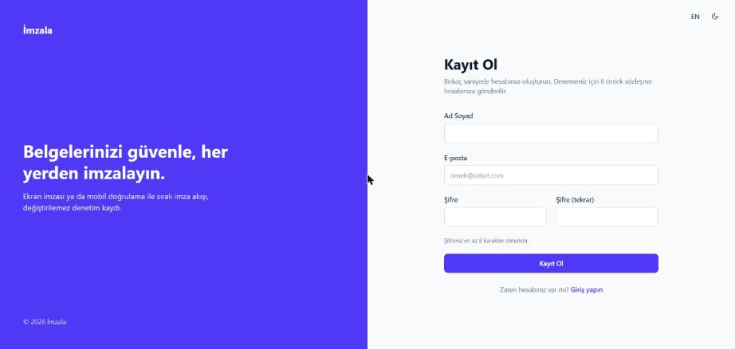
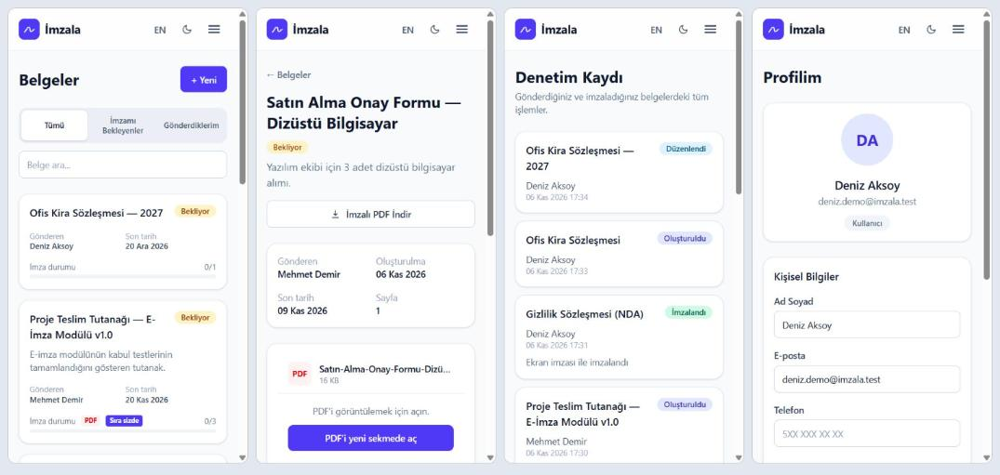

# İmzala — Electronic Signature Platform

İmzala moves paper-based signing into a traceable digital flow. A sender uploads a document (PDF or text),
picks the signers in order, and each signer signs on screen or with an SMS-verified mobile signature, or
rejects with a reason. Every step is written to a tamper-proof audit trail, and the result can be downloaded
as a signed PDF with a signature certificate.

> **Türkçe özet:** İmzala, ıslak imza gerektiren belgeleri sıralı elektronik imza akışına taşıyan bir web
> uygulamasıdır. PDF yükleme, ekran imzası, SMS doğrulamalı mobil imza, gerekçeli red, değiştirilemez denetim
> kaydı ve imza sertifikalı PDF indirme içerir. Arayüz Türkçe/İngilizce, açık/koyu tema ve mobil uyumludur.



## Features

| | |
|---|---|
| **Sequential signing** | Signers sign in a fixed order; only the person whose turn it is can act. |
| **Screen signature** | Draw with mouse, finger or pen (pointer events, retina-sharp canvas). |
| **Mobile signature** | 6-digit SMS code, hashed in the DB, 3-minute expiry, max 5 attempts. |
| **Reject with reason** | 10–500 characters; the document is closed for everyone. |
| **PDF documents** | Upload (max 10 MB), view in the browser, download the **signed PDF**: original pages + footer stamp on every page + signature certificate page (signers, drawn signatures, methods, SHA-256 of the original file, audit trail). |
| **Edit / delete** | Only the sender, and only before anyone has signed. Edits are logged. |
| **Profile** | Name, job title, email, phone, address; password change requires the current password. |
| **Audit trail** | Append-only (`created`, `updated`, `signed`, `rejected`) with IP and user agent. |
| **Sample contracts** | Every new account receives 6 sample contracts so the app can be tried immediately. |
| **Language** | Turkish / English UI; the API returns error messages in the requested language. |
| **Dark mode** | Follows the OS setting, can be switched manually, no flash on load. |
| **Responsive** | Phone, tablet and desktop layouts. |

## Screenshots

| Signing | Signature certificate (signed PDF) |
|---|---|
|  |  |
| **Mobile signature (dark, English)** | **Edit document** |
|  |  |
| **Dark mode + English** | **Sign up** |
|  |  |

**Mobile (375 px):**



## Tech stack

| Layer | Technologies |
|---|---|
| Frontend | Vue 3 (`<script setup>`), TypeScript, Vite, Pinia, Vue Router, axios, Tailwind CSS 4 |
| Backend | Node.js, Express 5, Mongoose 9 (MongoDB), JWT (httpOnly cookie), bcrypt |
| PDF | pdf-lib + fontkit, DejaVu Sans (full Turkish character support) |
| Tests | Vitest + Vue Testing Library + axios-mock-adapter (frontend), `node:test` (backend) |

## Getting started

Requirements: Node.js 22+, MongoDB (local or Atlas).

```bash
# 1) Backend  ->  http://localhost:3001
cd backend
npm install
# create backend/.env (variables below)
npm run dev

# 2) Frontend ->  http://localhost:3000
cd frontend
npm install
# create frontend/.env with VITE_API_URL=http://localhost:3001/api
npm run dev
```

Sign up at http://localhost:3000/register — the 6 sample contracts are already waiting for your signature.

### Environment variables

**backend/.env**

| Variable | Example | Description |
|---|---|---|
| `MONGO_URI` | `mongodb://127.0.0.1:27017/imzala` | MongoDB connection string |
| `PORT` | `3001` | API port |
| `FRONTEND_URL` | `http://localhost:3000` | Exact frontend origin (CORS + CSRF check) |
| `TOKEN_SECRET` | long random string | JWT signing secret — `node -e "console.log(require('crypto').randomBytes(48).toString('hex'))"` |
| `JWT_EXPIRE` | `7d` | Session lifetime |
| `NODE_ENV` | `production` | In production the OTP demo code is not returned and cookies are `Secure` |

**frontend/.env**

| Variable | Example |
|---|---|
| `VITE_API_URL` | `http://localhost:3001/api` |

### Scripts

| Where | Command | What it does |
|---|---|---|
| backend | `npm run dev` | API with auto-reload (nodemon) |
| backend | `npm test` | Backend tests |
| frontend | `npm run dev` | Vite dev server on port 3000 |
| frontend | `npm run build` | Type-check (`vue-tsc`) + production build |
| frontend | `npm test` | Frontend tests (Vitest) |

## Architecture

```
imza/
├── backend/
│   ├── index.js              # Express app: helmet, CORS, i18n, rate limit, body parsing, CSRF, routes
│   ├── routes/               # users, documents, audit
│   ├── controller/           # request handling + validation
│   ├── models/               # User, Document (embedded signers), DocumentFile (PDF bytes),
│   │                         # AuditLog (append-only), OtpCode (hashed, TTL)
│   ├── middleware/           # auth (JWT cookie), security (rate limit, NoSQL sanitize, CSRF), i18n
│   ├── services/
│   │   ├── pdf.js            # text -> PDF, signed PDF with stamp + certificate
│   │   └── sampleDocuments.js# 6 sample contracts for new users
│   └── tests/
└── frontend/                 # Vue 3 + Vite (see frontend/README.md)
    └── src/
        ├── router/           # routes + one auth guard (meta.auth / meta.guest)
        ├── stores/           # Pinia: auth (current user), preferences (language, theme)
        ├── lib/              # api (axios instance), i18n (TR/EN), types
        ├── components/       # ui/ (Base* kit), Navbar, SignPanel, SignaturePad, PdfViewer, DocumentForm
        └── views/            # Login, Register, Documents, NewDocument, DocumentDetail, EditDocument,
                              # Audit, Profile (lazy-loaded)
```

**Signing flow**

```
sender ──create──► Document (pending) ──► signer 1 ──sign──► signer 2 ──sign──► … ──► status: signed
                         │                    │
                         │                    └─reject (reason)──► status: rejected (closed)
                         └─ edit / replace PDF / delete: only before the first signature
```

- `Document.signers` is an ordered, embedded array. Signer name/title/email are **snapshots**: later profile
  changes do not rewrite a legal record.
- The document status is derived from its signers in a `pre("validate")` hook, so it can never drift.
- `optimisticConcurrency` on `Document`: two simultaneous sign/reject requests can't both win (HTTP 409).
- PDF bytes live in a separate `DocumentFile` collection, so listing documents never loads files.
- Frontend state lives in Pinia. The axios instance reads the language from the store for `Accept-Language`
  and turns every error into an `ApiError` with the backend's message. An inline script in `index.html`
  applies the saved theme before Vue starts, so dark mode never flashes white.

## API

All endpoints are under `/api`. Auth is an httpOnly `token` cookie, so requests are sent with credentials (axios `withCredentials`).
Send `Accept-Language: en` to get English messages.

| Method | Path | Description |
|---|---|---|
| POST | `/users/register` | Sign up (also creates the sample contracts) |
| POST | `/users/login` | Log in, sets the cookie |
| POST | `/users/logout` | Clears the cookie |
| GET | `/users/me` | Current user |
| GET / PUT | `/users/profile` | Read / update profile `{ name, title, email, phone, address, currentPassword?, newPassword? }` — `role` can't be changed here |
| GET | `/documents` | Documents I sent or sign |
| GET | `/documents/waiting/list` | Documents where it is my turn |
| GET | `/documents/sent/list` | Documents I sent |
| POST | `/documents` | Create `{ title, description, content[], pages, dueDate, signers: [email \| userId] }` |
| GET | `/documents/:id` | One document |
| PUT | `/documents/:id` | Edit (sender, before the first signature) |
| DELETE | `/documents/:id` | Delete (sender, before the first signature) |
| PUT | `/documents/:id/file` | Upload PDF — raw body, `Content-Type: application/pdf`, `X-File-Name` header |
| DELETE | `/documents/:id/file` | Remove the PDF |
| GET | `/documents/:id/file` | Original PDF |
| GET | `/documents/:id/signed-pdf?lang=tr\|en` | Signed PDF with signature certificate |
| POST | `/documents/:id/otp` | Send SMS code `{ phone: "5XXXXXXXXX" }` |
| POST | `/documents/:id/sign` | `{ method: "draw", signature }` or `{ method: "mobile", code }` |
| POST | `/documents/:id/reject` | `{ reason }` |
| GET | `/audit` | Audit entries of my documents |

## Security (OWASP Top 10)

| Risk | Measure |
|---|---|
| A01 Broken access control | Every query is scoped to the user (`sender` or `signers.user`); signing checks whose turn it is; edit/delete only by the sender before the first signature. |
| A02 Cryptographic failures | bcrypt password hashes; OTP codes stored as SHA-256 and compared in constant time; JWT in an **httpOnly**, `SameSite`, `Secure` (prod) cookie — not readable by JavaScript. |
| A03 Injection | `$`/dotted keys stripped from every body (NoSQL injection); ObjectIds validated; strict type checks on input. |
| A04 Insecure design | Audit log is append-only at the model level; optimistic concurrency; signer data snapshotted. |
| A05 Security misconfiguration | `helmet` headers; CORS limited to `FRONTEND_URL`; JSON body limit 100 KB; generic 500 messages (no stack traces). |
| A07 Authentication failures | Rate limits: 300 req/15 min for the API, 20 req/15 min for login/register; OTP max 5 attempts, 3-minute TTL. |
| A08 Integrity failures | Uploaded files must start with the `%PDF-` signature (not just the header); size limit 10 MB; SHA-256 fingerprint printed on the certificate. |
| CSRF | State-changing requests must come from `FRONTEND_URL` (Origin check) in addition to `SameSite` cookies. |
| Data exposure | Password is `select: false`; responses go through `toJSON` whitelists; IP/user agent never leave the server; demo sender accounts get random, unknown passwords. |

## Tests

```bash
cd backend && npm test     # 25 tests: models, security middleware, i18n, PDF generation
cd frontend && npm test    # 24 tests: api client, i18n, UI, router guards, SignPanel, DocumentForm, Profile
```

Frontend tests are user-focused: they type, click and check what the user sees (e.g. the reject button stays
disabled until the reason has 10 characters; the mobile flow strips `0` and spaces from the phone number;
choosing a non-PDF file shows an error; editing keeps signers read-only; a password change needs the current
password). `npm run build` also type-checks every component and test with `vue-tsc`.

## Known limitations / next steps

- SMS is not connected to a provider; in development the code is shown on screen.
- The signature is an application-level e-signature, not a qualified electronic signature (5070 sayılı
  Elektronik İmza Kanunu); integrating a qualified e-signature / mobile signature provider is the next step.
- PDFs are stored in MongoDB (max 10 MB); object storage (S3/MinIO) would suit larger files.
